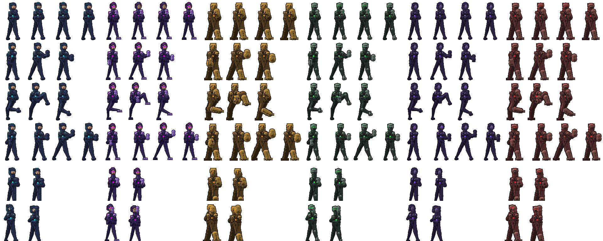

# SheetSmith

> Fighter sprite sheets forged from code.



SheetSmith собирает **спрайт-листы боевых персонажей из кода** — без единой
внешней зависимости, только стандартная библиотека Python. Персонаж описывается
**данными** (палитра + архетип), а не кодом: движок общий, различаются только
данные. Шестеро базовых бойцов — в репозитории, любой следующий добавляется
правкой JSON.

Проект растёт в две стороны: **движок** (командная строка, уже работает) и
**сайт-генератор** (редактор с живым превью, ростер, экспорт — в работе, план
в [PLAN.md](PLAN.md)).

---

## Быстрый старт

```bat
py char_generator.py --list                     :: список персонажей
py char_generator.py --hero tetrax --scale 3    :: превью одного (в preview/)
py char_generator.py --hero all --scale 1       :: ростер-лист со всеми сразу
py char_generator.py --hero tetrax --write      :: спрайт-лист в out/ (1:1)
py char_generator.py --characters my.json --hero cipher --write
py char_generator.py --dump-schema              :: схема описания персонажа (JSON)
```

| Флаг | Что делает |
|---|---|
| `--hero ID` | персонаж; `all` — ростер со всеми. По умолчанию `tetrax` |
| `--scale N` | во сколько раз увеличить **превью** (сам спрайт-лист всегда 1:1) |
| `--characters FILE` | JSON с новыми/переопределёнными персонажами |
| `--write` | записать спрайт-листы на диск (иначе только превью) |
| `--out DIR` | куда писать (по умолчанию `./out`) |
| `--list` | показать персонажей и их архетипы, выйти |
| `--dump-schema` | вывести границы и варианты описания персонажа, выйти |

Проверено на Python 3.9 / 3.11 / 3.14.

## Что получается

Спрайт-лист **80×128 на кадр, сетка 6 строк × 4 колонки** (18 заполненных кадров,
6 пустых ячеек прозрачные):

| строка | анимация | кадров |
|---|---|---|
| 0 | idle | 4 |
| 1 | punch | 3 |
| 2 | kick | 3 |
| 3 | super | 4 |
| 4 | stun | 2 |
| 5 | slip | 2 |

При каждом запуске печатается **рост в головах** — главная метрика
пиксель-арта человека. Если у нового персонажа вышло 3.8, значит он либо мелкий,
либо головы не того размера.

## Как описан персонаж

Два словаря. Палитра отвечает за цвет, архетип — за форму: без архетипа все
бойцы отличаются только цветом и читаются как перекрашенный клон.

```json
{
  "characters": {
    "cipher": {
      "materials": {
        "robe":  {"hi": "#2F6B5E", "base": "#1D463E", "dark": "#0F2620"},
        "armor": {"hi": "#7C8C74", "base": "#4E5C4A", "dark": "#2C3529",
                  "spec": "#DFFFE8", "spec_lam": 0.86, "spec_glow": 0.5},
        "skin":  {"hi": "#C8A882", "base": "#9A7C5C", "dark": "#64503C"},
        "eye": "#7CFFB2", "neon": "#39FF88", "neon_soft": "#14703C"
      },
      "arch": {
        "head": "mask", "torso": "taper", "hand": "claw", "foot": "wedge",
        "grip": "wrap", "SHOULDER": 24, "WAIST": 17,
        "ARM": 5, "LEG": 7, "ankle": 0.36
      }
    }
  }
}
```

**Палитра.** У каждого материала (`robe` / `armor` / `skin`) три тона
сел-шейдинга — свет, основной, тень — и необязательный блик: `spec` (цвет),
`spec_lam` (насколько узкий блик: сталь даёт всполох, кожа — мягкое пятно),
`spec_glow` (как он гаснет в глубине формы). `eye`, `neon`, `neon_soft` —
просто цвета.

**Архетип.**

| ключ | варианты | смысл |
|---|---|---|
| `head` | `hood` `visor` `monocle` `helm` `mask` `spike` | построение головы |
| `torso` | `taper` `box` `wide` | сужается к талии / прямоугольник куртки / широкие плечи |
| `hand` | `fist` `hammer` `claw` | кулак / кувалда / когти |
| `foot` | `boot` `wedge` `block` | сапог / плоский клин / плита |
| `grip` | `wrap` `plate` | кисти в обмотках или в броне |
| `SHOULDER` `WAIST` | px | ширина плеч и талии |
| `ARM` `LEG` | px | толщина руки и ноги |
| `ankle` | 0.32…0.70 | сужение ноги к стопе; 0.7 — почти параллельные ноги |

Полный пример с комментариями — в [characters.example.json](characters.example.json).

**Новый персонаж без правки кода.** Неизвестный id → создаётся новый и
добавляется в ростер; существующий → мержится поверх (чтобы поменять только
цвет неона у готового бойца, достаточно одной строки). Лишние ключи внутри
`arch` игнорируются, ключи с подчёркиванием (`_about_ru`) — свободные комментарии.

## Как это устроено

1. тело собирается в **маску** по позе — суставы, сегменты рук и ног;
2. по маске считается **поле расстояний** до края (chamfer 3-4);
3. из поля восстанавливается приблизительная **нормаль** поверхности;
4. свет падает **сверху-слева**, тон выбирается из трёх жёстких полос
   (highlight / base / shadow) — не градиент: сглаживание убивает язык
   пиксель-арта;
5. материалы накладываются по частям: ткань рясы, броня, кожа, неон по контуру;
6. силуэт обводится затемнённым тоном **своего** материала: чёрный контур на
   тёмной палитре проваливался бы в фон.

Анимации описаны точками суставов, поэтому движение правится числами, а не
перерисовкой: удар качает корпус назад, а мах ногой разворачивает таз. Позы
задаются **целью кисти или стопы**, промежуточный сустав считается двухзвенной
IK — длина конечности держится по построению.

| хочу | где крутить |
|---|---|
| новый вид головы | `head_*` + запись в `HEAD_BUILDERS` |
| новый вид кисти/стопы/торса | функции в `build_parts` / `_draw` |
| новую анимацию | `ANIMS` — список поз по строкам листа |
| новый размер кадра | `FW`, `FH` вверху; `render_frame` сам вписывает позу в кадр |
| палитру/пропорции | `MATERIALS` / `ARCH` вверху файла, либо `characters.json` |
| пиксельный слой (PNG, маски, масштаб) | `pixelcanvas.py` |

## Программный доступ

Движок импортируется как модуль. Рисование принимает **спецификацию
персонажа**, а не идентификатор, поэтому два черновика не могут перепутаться
местами — это то, за что цепляется любой многопользовательский рендер:

```python
import char_generator as G

spec = G.CharSpec.from_json("cipher", {
    "materials": {"robe": {"hi": "#2F6B5E", "base": "#1D463E", "dark": "#0F2620"},
                  "eye": "#7CFFB2", "neon": "#39FF88", "neon_soft": "#14703C"},
    "arch": {"head": "mask", "torso": "taper", "hand": "claw", "foot": "wedge",
             "grip": "wrap", "SHOULDER": 24, "WAIST": 17,
             "ARM": 5, "LEG": 7, "ankle": 0.36},
})

G.render_frame(dict(G.ANIMS)["punch"][1], spec)   # Canvas 80x128
G.build_sheet(spec)                               # Canvas 320x768
G.measure_heads(spec)                             # (5.22, 23, 120) — головы, голова, фигура
G.spec_warnings(spec)                             # подсказки редактору
G.validate_spec(data, "cipher")                   # что сломается до рендера
G.schema_json()                                   # границы и варианты для UI
```

`CharSpec.to_json()` возвращает описание в формате `characters.json`, поэтому
всё, что собрано в редакторе, уходит в CLI без конвертации.

## Тесты

```bat
py tests\test_spec_api.py            :: спецификация, JSON, валидация (секунды)
py tests\test_server.py              :: маршруты, кэш, задачи (~2 мин)
py tests\test_parity.py              :: картинка не поехала (6 героев, ~60 с)
py tests\test_parity.py --update     :: перезаписать эталон
```

Первый тест отвечает на вопрос «правильно ли движок описывает персонажа»,
второй — «то ли отдаёт сервер», третий — «не поехала ли картинка». Золотая
картинка лежит в репозитории, и её изменение видно в `git diff` как изменение
файла. Тест сервера сверяет лист из `/api/jobs/.../file` с эталоном CLI:
сайт и командная строка обязаны давать одну и ту же картинку.

## Сайт

Локальный сервер отдаёт превью кадрами и собирает спрайт-листы. Ни одной
зависимости: только стандартная библиотека Python, как и у движка.

```bat
py server\app.py                      :: http://localhost:8000
py server\app.py --host 0.0.0.0       :: доступ из локальной сети
py server\app.py --jobs 7             :: рендер в 7 процессах (быстрее в разы)
```

| Метод | Путь | Что делает |
|---|---|---|
| GET | `/api/health` | живо ли сервер, что в кэше |
| GET | `/api/schema` | варианты архетипа, границы, сетка анимаций |
| GET | `/api/presets` | шестеро базовых персонажей как описания |
| POST | `/api/preview` | PNG одного кадра (`anim`, `frame`, `scale`) |
| POST | `/api/measure` | рост в головах + предупреждения |
| POST | `/api/jobs` | долгий экспорт (`kind: sheet\|roster`), ответ `jobId` |
| GET | `/api/jobs/<id>` | статус задачи: `done` из `total` |
| GET | `/api/jobs/<id>/file` | готовый PNG |
| POST | `/api/save` | записать ассет в `out/` и героя в `characters.local.json` |

Ответ `/api/preview` несёт `X-Render-Ms`, `X-Cache` и размеры кадра — видно
в devtools, оттуда же понятно, что именно тормозит.

Повторный запрос того же кадра приходит из кэша мгновенно, а `--jobs` раскладывает
лист по кадрам между процессами: на 4 процессах лист собирается втрое быстрее и
**побайтово равен** тому, что собирает однопоточный движок.

Сохранённый из сайта герой сразу виден в CLI:

```bat
py char_generator.py --characters characters.local.json --list
```

## Интерфейс

Левая колонка — пресеты и контролы (палитра, архетип, пропорции), справа —
кадр выбранной анимации с плеером. Никакой сборки: обычные ES-модули, которые
сервер отдаёт как есть, поэтому `py server\app.py` сразу даёт рабочий интерфейс.

* варианты архетипа и границы ползунков берутся из `/api/schema`, а не из
  констант во фронтенде: движок — источник истины;
* устаревшие запросы превью отменяются, поэтому быстрое движение ползунка не
  оставляет на экране старую картинку;
* масштаб по умолчанию подбирается под окно, но целым числом — иначе
  пиксель-арт мылится;
* под кадром показывается рост в головах и предупреждения движка.

## Куда это движется

SheetSmith начинался как генератор спрайт-листов для файтинга, но цель шире:
персонажи **разных стилей** (чиби, мультяшный, 16-бит, ближе к реализму) и
**разной одежды** (от современной до фэнтези), для файтинга, битемапа и
приключенческих игр. На первом этапе — вид сбоку, на зрелом — спрайты в объёме.

Поэтому персонаж описывается данными (тело, архетип, материалы, скелет), а
пиксельный движок — один из потребителей этого описания. Подробный разбор: что
уже этому не мешает, что мешает и в каком порядке это правится — в
[PLAN.md](PLAN.md), раздел «Куда это движется».

## Движения

Анимации описаны **данными** в [data/animations.json](data/animations.json), а не
функциями Python. Кадр — это список операций над скелетом:

```json
{"shift": {"parts": ["head", "neck", "chest"], "dx": 0, "dy": 20}}
{"aim":   {"side": "f", "d": [27, 2], "bend": 1.0}}
{"step":  {"side": "b", "d": [-5, -1], "bend": 1.0}}
```

Смысл: новую анимацию добавляет правка файла, а одна и та же анимация
работает на любом теле — цели задаются смещениями от опорной стойки, а не
абсолютными пикселями кадра. Локоть и колено считаются двухзвенной IK.

В библиотеке **23 движения** в пяти разделах: покой (idle), движение (walk,
run, crouch, jump, fall, land, dash), защита (block), атака (jab, cross, hook,
uppercut, low_kick, round_kick, knee, throw, punch, kick, super) и реакция
(hit, stun, slip). Какие из них попадут в выгрузку, решают галочки: лист
строится под выбранный набор — строк столько, сколько движений, колонок
столько, сколько кадров в самом длинном.

## Выгрузка

Кнопка **«Скачать набор для игры»** отдаёт zip:

```
<имя>/sheet.png          весь набор: по строке движение, по колонке кадр
<имя>/animations/*.png   то же отдельным файлом на каждое движение
<имя>/<имя>.json         описание персонажа — принимается движком
<имя>/README.txt         раскладка: строки, кадры, что зацикливать
```

Либо единый спрайт-лист PNG одним файлом — если движку он удобнее целиком.

## Одежда

Раньше персонаж носил `robe` и `armor` — «либо ряса, либо броня», и что надето,
выводилось из хвата. Теперь части тела разделены на **слоты**, и на каждый слот
можно назначить свой материал:

| слот | что красит | по умолчанию |
|---|---|---|
| `body` | торс, шея, воротник | `robe` |
| `arms` | рука до кисти | `robe` |
| `hands` | кисть и наруч | ткань или броня по хвату |
| `legs` | штаны | `robe` |
| `feet` | сапог и наколенник | ткань или броня по хвату |
| `shoulders` | наплечники и плиты | `armor` |
| `head` | капюшон, шлем, волосы | `robe` |

```json
"outfit": {"body": "trench", "legs": "trousers", "feet": "shoes", "head": "skin"}
```

Слот можно и не указывать — тогда он берёт прежнее значение, и персонаж без
одежды рисуется **пиксель в пиксель как раньше** (это проверяет golden-тест).
Ноги, сапоги и кисти для этого вынесены в отдельные маски и объединены обратно:
силуэт и контуры не меняются, меняется только заливка.

В [data/outfits.json](data/outfits.json) — **10 комплектов**: кибер-монах,
стрит-рейсер, рыцарь, маг, ниндзя, спортсмен, строитель, тренч, мех, пляж.
Комплект — это палитра и привязка слотов; архетип он не трогает, поэтому
сочетается с любым телом и любыми цветами.

## Структура

```
char_generator.py          движок: палитры, архетипы, позы, сел-шейдинг, CLI
pixelcanvas.py             мини-библиотека пиксель-арта (Canvas, Mask, PNG)
characters.example.json    пример: новый персонаж + переопределение существующего
data/animations.json      библиотека движений: позы как операции над скелетом
data/outfits.json          библиотека одежды: комплекты и привязка слотов
server/app.py              HTTP-сервер сайта (только стандартная библиотека)
server/render.py           рендер-сервис: кэш кадров, пул процессов, задачи
PLAN.md                    план сайта-генератора: этапы, API, риски
docs/roster.png            ростер шестерых базовых персонажей
preview/                   превью (генерируется, в git не попадает)
out/                       готовые спрайт-листы (генерируется, в git не попадает)
legacy/                    старая версия 32×48 (силуэт + неон) — справка по позам
tests/                     тесты: API-слоя, сервера и эталон картинки
web/                       интерфейс сайта: index.html + ES-модули, без сборки
```

## Что дальше

Веб-интерфейс: локальный сервер отдаёт превью, редактор крутит палитру и
пропорции вживую, ростер хранится в браузере, экспорт — PNG и `characters.json`.
Подробности, замеры скорости и риски — в [PLAN.md](PLAN.md).

Короткая дорожная карта: golden-тесты → API-слой движка → бэкенд → фронтенд →
редактор → экспорт → ускорение.

## Требования

Python 3.9+ и больше ничего. PNG пишется своим мини-писателем на `zlib` и
`struct`, Pillow и numpy не нужны.

## Истоки

Движок вырос из генератора спрайтов для BlockBrawler и вынесен в отдельный
репозиторий, чтобы править картинку, не трогая игру. В `legacy/` лежит версия
32×48 — она нужна как справка по позам, новым персонажам идти надо в
`char_generator.py`.
